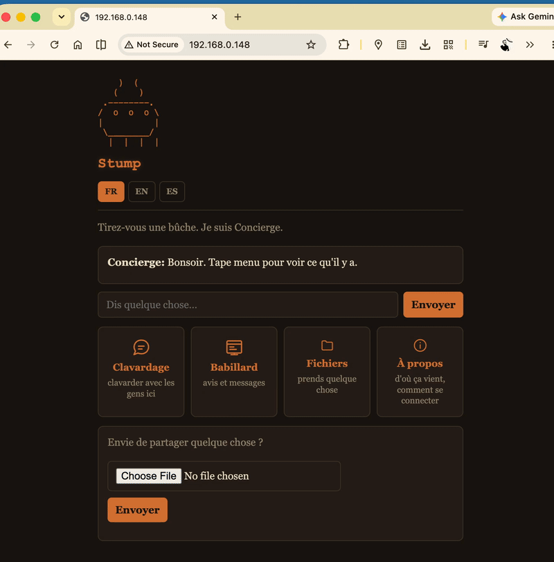

# Project Stump

[](https://github.com/ruderigo/SandBox_Stump_On/actions/workflows/tests.yml)
[](https://github.com/ruderigo/SandBox_Stump_On/releases)

An off-grid community node, in beta. **This repository is where Stump is
developed and released:** download a release from
[Releases](https://github.com/ruderigo/SandBox_Stump_On/releases), check it
([docs/RELEASE.md](docs/RELEASE.md)), and report what you find in Issues.
What changed: [CHANGELOG.md](CHANGELOG.md). Releases up to 1.0.0-beta.48 are
also in [LaBuche-Stump](https://github.com/ruderigo/LaBuche-Stump), which no
longer changes.



## What a Stump is

A Stump is an off-grid community node. Walk up with a phone, join its
Wi-Fi, and get chat rooms, a bulletin board, a file library and an About
page, in French, English or Spanish. It also holds a cryptographic
identity on the [Reticulum](https://reticulum.network) mesh, so people
reachable only over LoRa radio share the same rooms as the people
standing in front of it.

The same firmware runs on a small board or on a computer, with or
without a radio:

| Stump | Radio | What it adds |
|---|---|---|
| **ESP32-WROVER** (Freenove v3.0) **+ Heltec V3** | Heltec V3 over Wi-Fi | A pocket-sized, low-power node with its own Wi-Fi for visitors and an SD card for files: the kit |
| **ESP32-S3-CAM + Heltec V3** | Heltec V3 over Wi-Fi | The same on the ESP32-S3: more flash and memory |
| **macOS / Windows / Linux + Heltec V3** | Heltec V3 on USB or Bluetooth | A computer as a full node: more storage and speed |
| **macOS / Windows / Linux** | none | A computer with no radio: it reaches LoRa through a Stump it's chained to |

**Rooms.** `#main` stays on its Stump. `#lora-mesh` is the radio's room:
LoRa phones and handhelds land there, and the Stumps share it.
`#wifi-mesh` is shared by chained Stumps over Wi-Fi. Any other room can be
shared too, over a chain's Wi-Fi or (with care for airtime) over LoRa
(`/setchan`), and rooms can have ops and mods (`/op`, `/mod`).

**Chained Stumps** link over Wi-Fi (one's own, or the home Wi-Fi they
share) and relay for each other, so a Stump without a radio still reaches
the LoRa mesh through one that has one
([final_firmware/docs/CHAIN.md](final_firmware/docs/CHAIN.md)).

## Who connects to a Stump

| Client | How it connects |
|---|---|
| **Android**: [FireFly-Android](https://github.com/ruderigo/FireFly-Android) | Over LoRa, through its own Heltec V3, with its own identity; or over Wi-Fi, from FireFly's Stump panel |
| **Handheld** (R36S / R36MAX): [FireFly for RK3326](https://github.com/ruderigo/FireFly_RK3326_R36MAX_R36S) | Over LoRa, through its own Heltec V3 |
| **Sideband, MeshChat, MeshChatX** | Over LoRa or the network, as LXMF |
| **NomadNet** | Its Channels, through the NomadNet pack's RRC hub |
| **Any phone or computer** | A browser on the Stump's Wi-Fi (or the network it's on) |

## Quick start

**With Arborist (a page in the browser, nothing to install):**

1. From the latest [release](https://github.com/ruderigo/SandBox_Stump_On/releases),
   download `Arborist-<version>.html` (and `SHA256SUMS` to check it).
2. Open it in **Chrome or Edge** (Safari and Firefox can't reach USB), plug
   the board in, and choose **A new Stump**: its name, passwords, Wi-Fi and
   radio, then **Make my Stump**. It erases the board and writes the Stump
   image: about 5 minutes.
3. Then **Set up a Heltec V3**: it's filled in from the Stump just made.
   Plug the Heltec in (it must already run the RNode firmware) and press
   **Set up the Heltec**.
4. Copy the Arborist page into `tools/arborist/` on the Stump's SD card, so
   it's offered to whoever has the Stump.

**Update a Stump** puts a new release on a Stump and keeps its settings,
identity and chat. The **Settings** tab reads and changes a Stump's settings
over USB. All of it: [final_firmware/docs/ARBORIST.md](final_firmware/docs/ARBORIST.md).

**With the Provisioner (the terminal):** `python3 provisioner.py`, from a
release's `Stump-<version>.zip`. It also flashes Heltecs (the RNode
firmware, or a standalone relay) and sets up a Stump on a computer
(`--pc`): [docs/REFERENCE.md](docs/REFERENCE.md#setting-up-with-the-provisioner).

## Tested so far

| | On hardware | In the lab only |
|---|---|---|
| ESP32-WROVER + Heltec V3, made and set up with Arborist (the kit) | ✓ (beta.64, 12 Nov 2026) | |
| `#lora-mesh` between three Stumps with radios, one chained without | ✓ (beta.63-64, Nov 2026) | ✓ (simulated air) |
| ESP32-S3-CAM + Heltec V3 | ✓ | |
| macOS, no radio, chained to a CAM over the home Wi-Fi | ✓ | |
| macOS + Heltec V3 on USB | ✓ | |
| macOS + Heltec V3 over Bluetooth | in progress | ✓ (simulated RNode) |
| Windows / Linux, with or without a Heltec | | ✓ |
| Android (FireFly + Heltec V3) over LoRa, and over Wi-Fi | ✓ | |
| Handheld (FireFly + Heltec V3) over LoRa | ✓ | |
| Shared rooms across a chain (Bavard's duet on every Stump) | ✓ (beta.63) | ✓ |
| Ops and mods, total bans | | ✓ (beta.64) |
| Browsers: phones, a Windows PC on the home Wi-Fi | ✓ | |

What only hardware can check, and how: [docs/BENCH.md](docs/BENCH.md).
**Access modes** (`hybrid`, `mandatory`, room tiers) are implemented and
tested in the lab, not yet in the field: leave `AUTH_MODE` at `open` unless
you're testing them ([docs/REFERENCE.md](docs/REFERENCE.md#before-anything-else-access-modes-are-in-test)).

## Documentation

| | |
|---|---|
| [final_firmware/docs/COMMANDS.md](final_firmware/docs/COMMANDS.md) | Every command, with its replies |
| [final_firmware/docs/ARBORIST.md](final_firmware/docs/ARBORIST.md) | Making, updating and setting up Stumps and Heltecs in the browser |
| [final_firmware/docs/CHAIN.md](final_firmware/docs/CHAIN.md) | Chained Stumps |
| [final_firmware/docs/PACKS.md](final_firmware/docs/PACKS.md), [PLUGINS.md](final_firmware/docs/PLUGINS.md) | Packs and plugins: using them, writing them |
| [final_firmware/docs/PC.md](final_firmware/docs/PC.md) | A Stump on a computer |
| [final_firmware/docs/HTTPS_SETUP.md](final_firmware/docs/HTTPS_SETUP.md) | HTTPS |
| [final_firmware/docs/CLIENT_QUICKSTART.md](final_firmware/docs/CLIENT_QUICKSTART.md) | Building a client that talks to a Stump |
| [docs/REFERENCE.md](docs/REFERENCE.md) | How it all works: architecture, every part, the configuration, the Provisioner |
| [final_firmware/docs/ENGINEERING_NOTES.md](final_firmware/docs/ENGINEERING_NOTES.md) | Why things work the way they do |
| [docs/THREAT_MODEL.md](docs/THREAT_MODEL.md), [SECURITY.md](SECURITY.md) | Security |
| [docs/RELEASE.md](docs/RELEASE.md) | How releases are built, signed and checked |
| [docs/ROADMAP.md](docs/ROADMAP.md), [docs/TODO.md](docs/TODO.md) | What's next |

## Repository layout

```
final_firmware/     the Stump's firmware: every board and the computer run it
                    (docs/ inside ships on every Stump)
scripts/arborist/   Arborist, the browser page; built by scripts/build_arborist.py
image/              the Stump image: MicroPython with the Stump frozen in, per board
provisioner.py      the terminal tool: boards, Heltecs, computer Stumps, packs
packs/              packs: bavard, tavern, nomadnet, rnfs, simple
pc/                 the Stump on a computer (stump_pc.py)
tests/              the test suite (tests/README.md)
bench/              measurements on real boards
docs/               the reference, release, roadmap, threat model
.github/workflows/  tests on every push; images; signed releases on every tag
```

## Testing

```bash
sh scripts/build_micropython.sh ~/micropython-f32     # once
MICROPYTHON=~/micropython-f32/micropython python3 tests/run.py
python3 tests/arborist_test.py                        # Arborist (needs node; Playwright for its page)
```

The suite runs on every push and before every release. After changing a
firmware file, run `python3 scripts/update_manifest.py`. More:
[tests/README.md](tests/README.md), [docs/REFERENCE.md](docs/REFERENCE.md#testing).

## Credits

Built on [µReticulum](https://github.com/varna9000/micropython-reticulum)
(MIT, independently maintained and licensed on its own terms), a MicroPython
port of the Reticulum protocol originated by Mark Qvist. That protocol's own
[reference repository](https://github.com/markqvist/Reticulum) relicensed
away from MIT on 15 April 2025; nothing here depends on or incorporates code
under that later license, since µReticulum is the actual, separately-licensed
dependency.

The Heltec Bridge role runs
[RNode Firmware CE](https://github.com/liberatedsystems/RNode_Firmware_CE)
(GPL-3.0), and the standalone Heltec transport role runs
[microReticulum_Firmware](https://github.com/attermann/microReticulum_Firmware)
(GPL-3.0, and — despite the similar name — a different project from
µReticulum above, by a different author). Both are used as pre-built
binaries pulled directly from their own upstream releases and flashed
as-is; neither is included as source anywhere in this repository or in
`Stump-<release>.zip`, so this project's own code remains MIT throughout —
true today, and worth keeping true: see "What ends up in `/sd/tools/`" in
[docs/REFERENCE.md](docs/REFERENCE.md) for the one place that claim would need re-checking if it ever
changes (staging a real firmware binary for the browser flasher).

The **rnfs pack** (`packs/rnfs-pack/`) hands out
[rnfs](https://github.com/afit21/rnfs), written by **Afi Hogan**
([afit21](https://github.com/afit21)), MIT, together with **Reticulum**
(as rnspure) and **LXMF** by **Mark Qvist**
([reticulum.network](https://reticulum.network), Reticulum License),
unchanged, with their licences. The pack's own page, its `!rnfs` reply
and its Tools page section credit them in all three languages.

See `LICENSE` for this build's own terms and the full third-party list.
